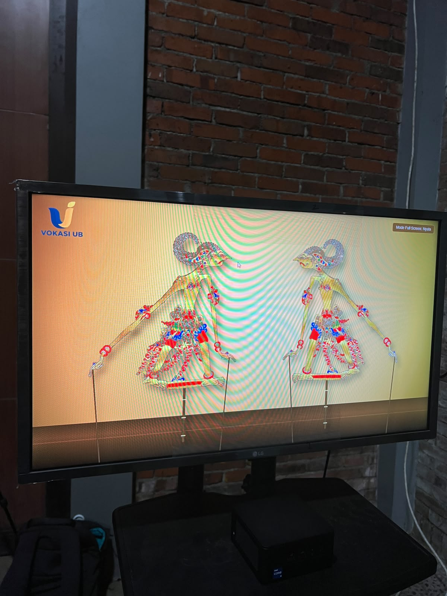
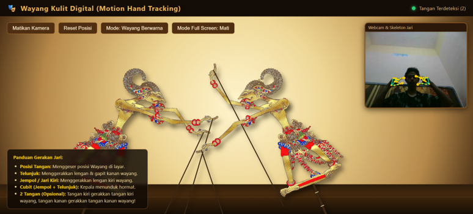
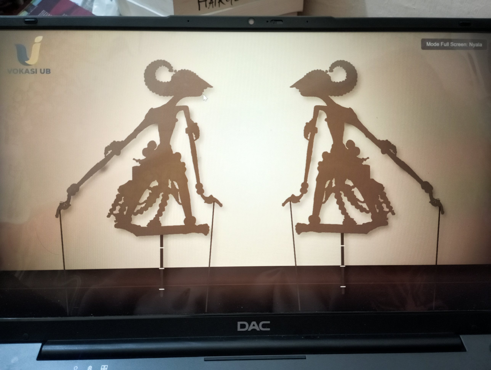

# Wayang Vokasi UB: Wayang Kulit Digital Interaktif Berbasis Gerak Tangan

> Wayang kulit digital yang digerakkan langsung oleh gerakan tangan pengunjung lewat kamera, tanpa sensor atau perangkat tambahan.



## Latar Belakang
Wayang kulit adalah warisan budaya yang sering terasa jauh bagi generasi muda karena umumnya hanya ditonton, bukan dicoba. Kami ingin menghadirkan pengalaman yang lebih dekat: pengunjung bisa "menjadi dalang" hanya dengan menggerakkan tangan di depan kamera.

## Solusi
Wayang Vokasi UB membaca gerakan tangan melalui webcam dengan MediaPipe Hand Landmarker, lalu menerjemahkannya menjadi gerakan dua wayang yang saling berhadapan di layar. Satu tangan mengendalikan satu wayang, sehingga dua orang atau dua tangan dapat memainkannya bersamaan.

## Fitur Utama
- Kendali wayang dengan gerakan tangan secara langsung lewat webcam
- Dua wayang yang identik dan saling berhadapan, masing-masing dikendalikan satu tangan
- Mode tampilan berwarna dan mode bayangan, dengan kecerahan yang menyesuaikan latar
- Tampil di peramban lewat localhost, mendukung layar penuh untuk pameran

## Cara Kerja
1. Webcam menangkap tangan pengguna.
2. Program deteksi lokal (`wayang_hybrid.py`) membaca titik-titik landmark tangan memakai model `hand_landmarker.task`.
3. Data gerak dikirim ke peramban melalui WebSocket.
4. `index.html` menggambar wayang dan menggerakkannya sesuai gerakan tangan.

Deteksi tangan dijalankan secara native di komputer lokal, sedangkan peramban hanya bertugas menampilkan. Pembagian ini dipilih karena deteksi di dalam peramban terlalu lambat.

## Demo
- Video demo: https://drive.google.com/file/d/1kj3skG_ZH2_AikVwwfmfY86mouq9qJ-I/view?usp=sharing 
- Coba langsung: https://github.com/haikalmuhammadarrabani-creator/Wayang_Digital/blob/main/wayang_hybrid.py
- Dipamerkan di: DIPA MediaArt Festival 2026, Gazebo Raden Wijaya, Universitas Brawijaya, Malang (27 Oktober 2026)

## Tangkapan Layar
| Tampilan awal | Wayang berwarna | Mode bayangan |
|---|---|---|
|  |  |  |
| 
## Teknologi yang Digunakan
- HTML, CSS, JavaScript (tampilan di peramban)
- Python (`wayang_hybrid.py`, deteksi tangan lokal)
- MediaPipe Hand Landmarker (`hand_landmarker.task`)
- WebSocket (pengiriman data gerak ke peramban)

## Cara Menjalankan
**Prasyarat:** komputer dengan webcam, Python 3.14.7, peramban terbaru (Edge/Chrome).

```bash
# 1. Unduh repositori
git clone https://github.com/haikalmuhammadarrabani-creator/Wayang_Digital

# 2. Masuk ke folder
cd Wayang_Digital

# 3. Pasang pustaka yang dibutuhkan
pip install mediapipe opencv-python

# 4. Jalankan program deteksi
python wayang_hybrid.py

# 5. Buka di peramban
# http://localhost:8123
```

> Buka halaman lewat `localhost`, bukan dengan membuka `index.html` langsung (`file://`).

## Struktur Folder
```
[nama-folder]/
├── index.html           # tampilan wayang di peramban
├── wayang_hybrid.py     # deteksi tangan lokal dan pengiriman data gerak
├── hand_landmarker.task # model MediaPipe Hand Landmarker
└── screenshots/         # gambar dokumentasi
```

## Pengujian
- Pada versi awal (seluruh proses di peramban), deteksi tangan dengan dua tangan hanya sekitar 7-8 FPS sehingga gerakan wayang patah-patah.
- Setelah deteksi dipindah ke program lokal (native), deteksi naik menjadi sekitar 17-20 FPS dengan waktu inferensi sekitar 17-20 ms.
- Uji coba pengunjung saat pameran: 14 orang. Salah satu masukan yang diterima adalah menambah lakon wayang agar lebih beragam.

## Kendala dan Perbaikan
- Gerakan wayang patah-patah di peramban → deteksi tangan dipindah ke program native lokal, peramban hanya menampilkan.

## Catatan Aset
Gambar wayang yang digunakan pada prototipe ini bersumber dari hasil pencarian daring dan dipakai untuk keperluan prototipe. Pemilik dan lisensinya sedang ditelusuri; aset akan dimintakan izin atau diganti dengan aset berizin sebelum dipublikasikan lebih luas.

## Status dan Rencana Pengembangan
- Status saat ini: purwarupa yang sudah diperagakan di pameran
- [ ] Menambah lakon dan tokoh wayang
- [ ] Mengganti aset gambar dengan aset berizin
- [ ] Pergerakan wayang yang lebih fleksibel

## Tim
- Dosen pembimbing: Rachmad Andri Atmoko, S.ST., M.T.
- Haikal Muhammad Ar-rabani - Pengembang Fitur & Sistem Interaktif Wayang
- Dylan Leonardo Pratama - Pengembang Website 

Program Studi Teknologi Rekayasa Perangkat Lunak, Fakultas Vokasi, Universitas Brawijaya.

## Kontak
haikalmuhammadarrabani@gmail.com
